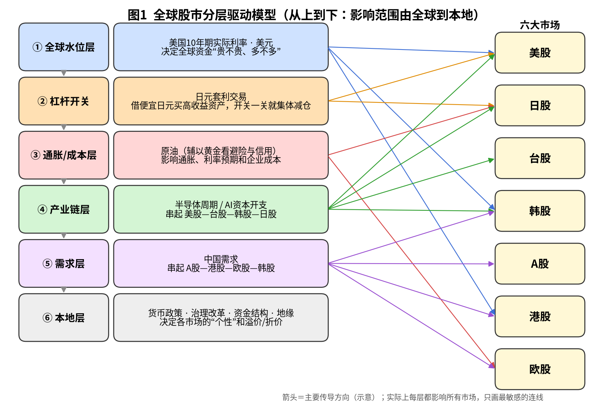
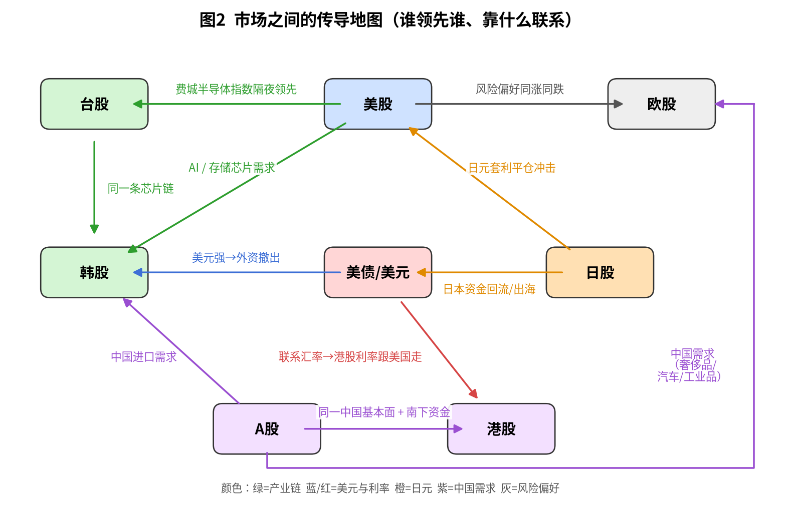
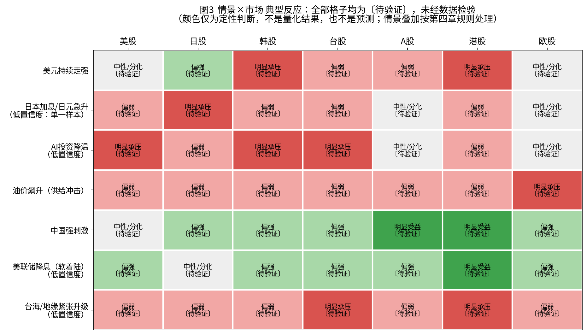

# 全球股市研究体系（第五版）

> 一套可反复使用的分析框架：先看全球“水位”，再看杠杆、成本、产业链、需求，最后看每个市场自己的“个性”。本文只讲方法，不含任何实时数据。

**覆盖范围**：美股、日股、韩股、台股、A股（附港股）、欧股；宏观指标：美国10年期实际利率、美元、美债、原油、黄金、日元。不含印度。

**怎么读每条规律旁的标签**（第六章会讲怎么检验和什么时候作废）：

| 标签 | 大白话 | 怎么用 |
|---|---|---|
| 〔因果〕 | 有清楚的机制，A 变了会“推着”B 变 | 可以作为主要判断依据，但仍要定期复核 |
| 〔相关〕 | 经常一起动，但不一定谁推谁，可能是共同受第三个因素影响 | 只作参考，不能单独下结论 |
| 〔待验证〕 | 听起来合理、市场常讲，但样本少或容易事后编故事 | 先当假设，按第六章检验通过后才升级 |

同一条规律可能分两层标注：例如“机制〔因果〕；对股价的影响〔待验证〕”，意思是道理讲得通，但对股价的实际影响方向或强度还没用数据证实。

---

## 一、总纲：分层驱动模型

**核心思路**：股市涨跌像水面上的船。全球资金的“水位”决定所有船一起高还是低；产业链和需求决定哪几条船走得快；本地因素决定每条船自己的结构和毛病。分析时**从上往下看**，越上层影响越广、越下层越有个性。

| 层级 | 核心变量 | 大白话 | 主要影响 |
|---|---|---|---|
| ① 全球水位层 | 美国10年期实际利率、美元 | 实际利率＝扣掉通胀后的真实借钱成本，实际利率越高，钱越贵；对估值的压力主要来自央行收紧推动的那种上升，见第六章〔待验证〕。美元越强，钱越往美国回流 | 全部市场，尤其高估值成长股和新兴市场 |
| ② 杠杆开关 | 日元套利交易 | 套利交易＝借利率很低的日元，换成别的货币去买收益更高的资产；日元突然升值时，借钱的人被迫一起卖资产还钱 | 日股、美股科技、各类高杠杆仓位 |
| ③ 通胀/成本层 | 原油（黄金作辅助） | 油价影响通胀，进而影响加息预期，也直接影响企业成本；黄金反映避险需求和对货币信用的担心 | 能源进口国（欧、日、韩、台、中国）、利率预期 |
| ④ 产业链层 | 半导体周期、AI资本开支 | 资本开支＝企业花钱买设备、建数据中心；美国巨头的AI投入就是台韩日芯片企业的订单 | 美股科技、台股、韩股、日股设备与材料 |
| ⑤ 需求层 | 中国需求 | 中国买多少原材料、设备、奢侈品、汽车 | A股、港股、欧股（奢侈品、汽车、工业）、韩股 |
| ⑥ 本地层 | 政策、治理改革、资金结构、地缘 | 每个市场“谁在买、规则怎么定、有什么风险” | 决定各市场相对其他市场的溢价或折价 |

**使用规则**：

1. 先判断①②是“放水”还是“抽水”，再谈其他层。〔待验证〕水位层与股市的关系会随时期翻转，见第六章。
2. 上层出现剧烈变化（如实际利率急升、日元急升）时，下层的好消息往往被盖过。〔待验证〕
3. 上层平稳时，市场之间的差异主要由④⑤⑥决定，这时才适合做“选市场、选行业”。〔相关〕

---

## 二、六大市场分析卡

每张卡固定五栏：核心驱动 / 结构特点 / 关键观察指标 / 典型风险情景 / 与其他市场的传导。

### 2.1 美股

- **核心驱动**
  - 美联储（美国央行）的利率路径：决定无风险收益率，也就是“存钱不冒险能赚多少”。机制〔因果〕；对股价涨跌方向的影响〔待验证〕（与第三章实际利率一行口径一致）。
  - 科技巨头的盈利与AI资本开支：指数涨跌很大程度取决于少数巨头的业绩和投入计划。〔因果〕
- **结构特点**
  - 集中度高：市值最大的少数公司占指数比重很大，“指数涨”不等于“大部分股票涨”。
  - 被动基金：跟踪指数自动买卖的基金（如指数ETF）。资金按市值分配，越大的公司被买得越多，会放大集中度。〔相关〕
  - 回购：公司用自己的钱买回自家股票，是长期稳定的买盘来源；财报前后的“回购静默期”买盘会变少。〔因果〕
- **关键观察指标**：美国10年期实际利率；FOMC（美联储议息会议）点阵图和发布会措辞；巨头季度资本开支指引；指数的等权重与市值加权表现差距（看上涨是否只靠少数公司）；VIX（大白话：美股“恐慌指数”，由期权价格算出，越高代表市场越紧张）。
- **典型风险情景**
  - 通胀反弹导致降息预期落空、实际利率上升 → 高估值科技股回调。
  - AI投入回报受质疑、巨头下调资本开支 → 指数和全球芯片链一起回调。
  - 集中度过高时，少数巨头一齐出事 → 指数跌幅大于多数个股。
- **传导关系**：美股科技与费城半导体指数影响次日台股、韩股的开盘方向〔待验证〕；美股风险偏好影响欧股〔相关〕；美联储政策通过美元和利率影响全部市场〔因果〕。

### 2.2 韩股

- **核心驱动**
  - 存储芯片周期，尤其HBM（高带宽内存：叠起来的高速内存芯片，AI服务器的关键部件）。存储价格涨跌直接决定韩国龙头企业利润。〔因果〕
  - 外资进出：外资是边际定价者（大白话：决定价格往哪边变的往往是最后加减仓的那批人）。〔待验证〕
- **结构特点**
  - 权重高度集中在少数半导体龙头，指数很像“存储周期指数”。
  - “韩国折价”：同类公司在韩国上市，估值常低于其他市场。常见解释是家族财阀结构、分红少、小股东保护弱。
  - Value-up（企业价值提升计划）：韩国政府推动上市公司提高分红、回购、公开估值改善计划，是对“韩国折价”的针对性改革，效果需要持续跟踪。〔待验证〕
  - 散户杠杆：散户借钱炒股（信用融资）比例较高，下跌时容易出现被迫平仓、加速下跌。〔待验证〕（被迫平仓的机制说得通，但“比例较高”尚无数据支撑，需补融资余额数据后再判断）
- **关键观察指标**：存储芯片合约价走势；韩国每月及每月前20天的出口数据（尤其半导体）；外资每日净买卖；韩元兑美元汇率；融资余额；Value-up相关企业公告与政策进展。
- **典型风险情景**
  - 存储价格见顶回落 → 盈利预期下修，指数领跌。
  - 美元走强、韩元贬值 → 外资撤出，形成“股跌—汇跌—再撤资”的循环。〔待验证〕（这是先后顺序的判断，检验时要先把汇率因素拆出来，并用隔天数据对齐时差，见6.2.3）
  - 治理改革进展低于预期 → 折价修复的逻辑失效。
- **传导关系**：受美国AI需求带动〔因果〕；与台股同属芯片链，经常同步〔相关〕；中国进口需求影响化工、钢铁、汽车零部件等〔因果〕；对美元和全球风险偏好特别敏感〔相关〕。

### 2.3 台股

- **核心驱动**
  - 台积电：单一公司在指数里权重极高（事实，权重以台湾证券交易所公布的加权指数成分权重为准）；“看懂台积电就看懂了台股的大半”是说法，标〔相关〕。
  - 全球AI与半导体需求：台股供应链（晶圆代工、封测、服务器组装、散热等）几乎都与此相关。〔因果〕
- **结构特点**
  - 极度集中，指数表现和“中位数个股”可能完全不同。
  - 费城半导体指数（SOX，美国上市芯片公司的指数）在美国交易时段先反映消息，台股次日开盘常跟随。这种“领先”可能只是时区差造成的，见第六章。〔待验证〕
  - 外资与新台币是**同步指标**：外资买超时往往伴随新台币升值，两者同时发生，一般不能用其中一个提前预测另一个。〔相关〕
  - 本地资金：寿险公司（持有大量海外资产，对汇率和避险成本敏感）和快速增长的ETF（尤其高股息ETF）资金是重要买盘来源。〔相关〕
- **待做检验**：美国实际利率对台股、韩股的影响，同时看本币回报和美元回报；采用6.2.2的利率划分规则；样本用台积电、三星、SK海力士，拿大盘（台湾加权指数、KOSPI）作对照组。详见6.2.3。〔待验证〕
- **关键观察指标**：台积电月营收与法说会（业绩说明会）指引；台积电在加权指数中的权重（台湾证券交易所）；费城半导体指数；外资每日买卖超；新台币汇率；ETF规模变化；融资余额。
- **典型风险情景**
  - AI投资降温 → 台积电及AI供应链估值同步收缩。
  - 两岸关系紧张 → 市场通常以“短线急跌、外资避险”的方式定价；若事件未升级，往往较快修复。真正长期影响取决于事态是否改变供应链与贸易。〔待验证〕（样本很少，结论为低置信度）
  - 新台币快速升值 → 寿险汇损、出口商利润受压。〔因果〕
- **传导关系**：受美股科技与SOX带动〔相关/待验证〕；与韩股同链〔相关〕；地缘风险会外溢到全球芯片供应链〔因果〕。

### 2.4 A股（附港股）

- **核心驱动**
  - 政策主导：货币、财政、产业、资本市场政策的方向和力度是最大变量。注意防止“什么都用政策解释”，见第六章。〔待验证〕
  - 国内基本面：地产（影响居民财富和地方财政）、通缩压力（大白话：物价持续偏弱，企业收入和利润难增长）。〔因果〕
- **结构特点**
  - 散户交易占比高，情绪与主题轮动快；“国家队”（与政府相关的稳定市场资金）在关键时刻托底。
  - 资金相对封闭，与海外市场的相关性低于其他市场。〔待验证〕（目前无数字支持，以后用滚动相关系数检验）
  - 北向资金＝外资通过“沪深港通”买A股；南下资金＝内地资金通过港股通买港股。〔相关〕
- **关键观察指标**：社融与信贷数据（全社会融资规模，大白话：经济里新借了多少钱）；PMI（采购经理指数，大白话：企业采购经理对“下个月好不好”的打分，50以上代表扩张）；CPI与PPI（消费品和出厂价格）；地产销售与新开工；人民币汇率；中美利差（中国利率减去美国利率）；重要会议与政策发布。
- **典型风险情景**
  - 地产与通缩持续、政策力度不及预期 → 盈利下修，市场缺少增量资金。
  - 中美利差扩大、人民币承压 → 限制货币宽松空间。〔因果〕
  - 中美贸易与科技摩擦升级 → 风险偏好下降。
- **港股的特殊性（重点）**：**中国基本面 + 美国资金面**。
  - 公司大多是中国企业，盈利看中国经济。〔因果〕
  - 港币通过“联系汇率制度”与美元挂钩（固定在很窄的区间内），所以香港利率基本跟随美国利率，美国加息/降息直接影响港股的资金成本〔因果〕（制度决定）；但“直接影响估值”这一层〔待验证〕，因为港股估值同时受中国盈利影响，两件事要分开看。
  - 主要投资者是国际资金和南下资金，权重大量集中在互联网平台公司，所以对“中国增长 × 美国利率 × 监管政策”三者同时敏感。〔相关〕
  - 观察指标：HIBOR（香港银行间利率）、香港金管局总结余（大白话：银行体系里的港币“备用金”多少）、南下资金净买入、互联网龙头业绩。
- **传导关系**：中国需求影响欧股、韩股、大宗商品〔因果〕；港股是海外资金表达“看多/看空中国”的主要窗口〔相关〕。

### 2.5 日股

- **核心驱动**
  - 走出通缩：物价和工资开始持续上涨，企业有了提价能力，名义盈利改善。〔因果〕
  - BOJ（日本央行）政策正常化：从超低利率逐步加息，影响日元、银行股、估值。〔因果〕
  - 日元：日元贬值利好出口企业利润（海外收入换回日元变多），升值则相反。会计机制〔因果〕；与股价的关系会随时期变化（如BOJ进入加息阶段后），对股价的影响〔待验证〕。
- **结构特点**
  - 东证PBR改革：东京证券交易所要求上市公司重视资本成本和股价，特别是市净率（PBR，大白话：股价相对公司账面净资产的倍数，低于1代表市场认为公司“不值账面价”）偏低的公司，推动回购、分红、出售交叉持股。〔待验证〕
  - 海外投资者是边际买卖力量；日本企业回购、个人投资者（新版NISA免税账户）是重要本地资金。〔相关〕
- **关键观察指标**：日元兑美元；日美利差；BOJ会议与行长发言；春季劳资谈判（“春斗”）加薪结果；日本CPI；外国投资者买卖周度数据；东证改革披露进展。
- **日本资金回流对美债的影响**：日本是美债的主要海外持有者之一。若日本国内利率上升、对冲汇率成本后买美债不划算，日本机构可能减少买美债甚至把钱调回国内，推高美国长期利率。〔待验证〕
- **典型风险情景：2024年8月套利平仓（参考案例，待核实）**
  - 说明：下面关于BOJ当时的表态、美国就业数据的描述尚未附来源，需对照日本银行（boj.or.jp）和美国劳工统计局（bls.gov）官网核对日期与出处，核对前一律视为“待核实”。
  - 经过：2024年7月末BOJ加息并释放偏鹰信号，紧接着美国就业数据偏弱、市场转向预期美联储较快降息，日美利差预期收窄，日元快速升值。借日元的套利仓位被迫平仓，8月初日股单日暴跌，全球股市波动率急升，随后数日大幅反弹。
  - 启示：日元急升＋全球杠杆高时，日股和美股科技会被“错杀”。但**这几乎是唯一的近期样本**，不能据此总结成固定规律。〔待验证〕
- **传导关系**：日元是全球杠杆的“开关”〔待验证〕；日股设备与材料企业属半导体链〔因果〕；日本资金流向影响美债〔待验证〕。

### 2.6 欧股

- **核心驱动**
  - ECB（欧洲央行）利率政策：欧元区通胀与增长之间的平衡。〔因果〕
  - 能源价格：欧洲是能源净进口地区，油气价格上涨直接压制工业利润和居民消费。〔因果〕
- **结构特点**
  - 缺少大型科技股，权重偏向银行、能源、工业、消费品、医药，整体估值长期低于美股。这是结构差异，不能简单认为“便宜就会涨”。〔相关〕
  - 德国财政与军费：德国放宽债务限制、加大国防和基建投入，利好国防、工业、建筑等板块，但执行节奏需跟踪。〔待验证〕
  - 海外营收占比高：大量收入来自欧洲以外，奢侈品、汽车、工业设备对中国需求特别敏感。〔因果〕
- **关键观察指标**：ECB会议决议；欧元区通胀（HICP）；欧洲天然气与原油价格；德国ifo商业景气指数；欧元区PMI；奢侈品与汽车公司财报中的中国区收入；德国财政预算执行情况。
- **典型风险情景**：能源价格飙升 → 工业与消费承压；中国需求疲弱 → 奢侈品、汽车下修；全球风险偏好下降 → 跟随美股调整。
- **传导关系**：中国需求→欧洲出口商〔因果〕；美股风险偏好→欧股〔相关〕；俄乌与中东局势→能源→欧股〔因果〕。

---

## 三、宏观指标仪表盘

| 指标 | 代表什么（大白话） | 怎么解读 | 主要影响市场 | 标签 |
|---|---|---|---|---|
| 美国10年期实际利率 | 扣掉通胀后的长期真实借钱成本，用10年期TIPS（通胀保值国债）收益率衡量，数据代码：FRED `DFII10` | 上升＝钱变贵，可能压估值，尤其成长股和黄金；下降相反。要区分是“经济变好”还是“央行收紧”推动的（划分规则见6.2.2） | 全部，尤其美股科技、港股、黄金 | 机制〔因果〕；对股价方向〔待验证〕，方向随时期可能翻转 |
| 10年期盈亏平衡通胀率 | 市场预期未来10年的平均通胀，数据代码：FRED `T10YIE` | 与实际利率一起看：实际利率和它同时上升，偏“增长推动”；实际利率上升而它不动或下降，偏“紧缩推动”（规则见6.2.2） | 用于拆分利率变动，间接影响全部市场 | 〔相关〕（划分工具，本身不是交易信号） |
| 美元 | 美元相对一篮子货币的强弱 | 走强＝全球资金回流美国、新兴市场承压；走弱＝资金外溢 | 韩股、台股、港股、A股、大宗商品 | 〔相关〕 |
| 美债收益率（2年/10年） | 2年期反映对美联储短期利率的预期，10年期反映长期增长、通胀和风险补偿 | 2年期看政策预期；10年减2年的利差（期限利差）反映经济周期 | 全部 | 〔相关〕 |
| 原油 | 全球通胀和成本的核心变量 | 需求带动的上涨通常问题不大〔待验证〕；供给冲击带来的上涨对进口国不利 | 欧股、日股、韩股、台股、A股；美股能源板块受益 | 〔因果〕 |
| 黄金 | 避险资产，也反映对货币信用和地缘的担心 | 一般与实际利率反向，但若央行大量购金，这一关系会变弱〔待验证〕 | 情绪参考；黄金矿业股 | 〔相关〕关系已出现偏离 |
| 日元 | 全球低成本融资货币、避险货币 | 突然急升＝套利平仓风险；持续贬值＝利好日本出口股，但可能引发日本当局干预 | 日股、美股科技、全球杠杆仓位 | 〔待验证〕作为“杠杆开关” |
| VIX（辅助） | 美股恐慌指数 | 急升代表去杠杆和避险 | 全部 | 〔相关〕 |

**读仪表盘的顺序**：实际利率与美元（水位） → 日元（开关） → 原油（成本） → 黄金与VIX（情绪确认）。

---

## 四、传导链与情景推演

> 下表是“典型反应方向”，用于提前想清楚可能的连锁反应，**不是预测**。**热力图和下表的全部格子均为〔待验证〕，未经数据检验**；颜色深浅只是定性判断，不是量化结果。实际反应还取决于当时的估值、仓位和预期。

| 情景 | 传导链（大白话） | 美股 | 日股 | 韩股 | 台股 | A股 | 港股 | 欧股 | 资产 | 依据 |
|---|---|---|---|---|---|---|---|---|---|---|
| 美元持续走强 | 美国利率高/经济强 → 资金回流美国 → 新兴市场货币贬值、外资流出 | 中性 | 偏强（日元弱利好出口） | 明显承压 | 偏弱 | 偏弱 | 明显承压 | 中性 | 黄金偏弱、商品偏弱 | 机制推理；尚无系统性历史检验，待用滚动相关核对 |
| 日本加息/日元急升 | 日美利差收窄 → 套利仓位平仓 → 高杠杆资产被卖 | 偏弱（科技首当其冲） | 明显承压 | 偏弱 | 偏弱 | 中性 | 偏弱 | 中性 | 日元升、波动率升 | 主要参考2024年8月，单一样本，**低置信度**；按6.2.1做事件研究后更新 |
| AI投资降温 | 巨头削减资本开支 → 芯片订单预期下修 → 芯片链估值收缩 | 明显承压 | 偏弱（设备材料） | 明显承压 | 明显承压 | 中性（相对抗跌） | 偏弱 | 中性 | 美债可能受益 | 机制推理（资本开支→订单）；尚无完整的历史降温样本，低置信度 |
| 油价飙升（供给冲击） | 成本上升 → 通胀预期上升 → 降息推迟 → 进口国受损 | 偏弱（能源股受益） | 偏弱 | 偏弱 | 偏弱 | 偏弱 | 偏弱 | 明显承压 | 黄金偏强、实际利率可能升 | 机制推理；需区分供给冲击与需求带动，历史样本待整理 |
| 中国强刺激 | 信贷与财政扩张 → 内需与进口回升 → 商品和对华出口受益 | 中性 | 偏强 | 偏强 | 偏强 | 明显受益 | 明显受益 | 偏强（奢侈品/汽车/工业） | 铜、铁矿石偏强 | 机制推理；需按6.2第4行用中国进口、信贷脉冲、PMI定义后检验 |
| 美联储降息（软着陆） | 利率下降、经济未衰退 → 全球资金成本下降 | 偏强 | 中性（日元升抵消） | 偏强 | 偏强 | 偏强 | 明显受益（港币利率跟降） | 偏强 | 美元偏弱、黄金偏强 | 机制推理；“软着陆”需事后才能确认，样本少，低置信度 |
| 台海/地缘紧张升级 | 避险情绪 → 芯片供应链风险溢价上升 | 偏弱 | 偏弱 | 偏弱 | 明显承压 | 偏弱 | 明显承压 | 偏弱 | 黄金、日元、美债偏强 | 机制推理；样本很少，**低置信度** |

**用法**：遇到新事件时，先判断它属于哪一类情景（或几类叠加），沿传导链逐层核对指标是否真的在动，**指标没动，就不要把这个情景当成正在发生**。

**情景叠加时的处理规则**：

1. **以实际在动的指标为准**：表中有些格子隐含了前提，例如“美元走强时日股偏强”默认日元同时走弱。若同期日元其实在急升（即“美元走强”和“日元急升”同时出现），日股以“日本加息/日元急升”一行为准。
2. **上层优先**：两个情景对同一市场方向冲突时，按第一章的层级，上层（水位层、杠杆开关）优先于下层（产业链、需求、本地）。〔待验证〕，层级顺序以后要用 6.1 的方法检验。
3. **不做加减**：冲突的格子不把“偏强”和“偏弱”相加抵消，而是记为“分化”，并写明是哪两个情景在拉扯。
4. **对称性核对**：“美联储降息（软着陆）”不是“美元持续走强”的简单反面。它同时包含美元偏弱、利率下降、经济不衰退三个因素，所以两行方向大体相反，但不要求逐格镜像。例如日股：美元走强时因日元弱而偏强，降息时日元走强，抵消了利好，所以记为中性，而不是偏弱。这说明两行不是逐格镜像。每次修改情景表时都要重新做这项核对。

---

## 五、研究流程

### 5.1 节奏表

| 频率 | 看什么 | 目的 |
|---|---|---|
| 每日（10分钟） | 美股收盘与SOX；美国10年期实际利率与美元；日元；原油、黄金；VIX；台韩外资买卖与汇率；北向/南下资金 | 判断“水位”和“开关”有没有异动 |
| 每周（1小时） | 美国初请失业金与重要数据；EIA原油库存；CFTC持仓（日元、黄金等）；日本外国投资者买卖；各市场资金流；本周重要会议回顾 | 判断趋势是否延续，更新仪表盘 |
| 每月（半天） | 各国CPI与PMI；美国非农就业；中国社融、进出口；韩国出口；台积电月营收；全球半导体销售；央行会议；TIC（美国财政部公布的外国持有美债数据） | 校验各市场分析卡，更新情景概率 |
| 每季 | 巨头财报与资本开支指引；各市场盈利预期变化；治理改革进展；第六章各条规律的复核 | 检查框架本身是否需要修改 |

### 5.2 公开数据来源（均为官方或主要机构网站）

| 类别 | 来源 | 网址 |
|---|---|---|
| 美国宏观（实际利率 `DFII10`、盈亏平衡通胀率 `T10YIE`、美元兑日元 `DEXJPUS`、广义美元指数 `DTWEXBGS`、布伦特原油 `DCOILBRENTEU`、国债收益率等） | 圣路易斯联储经济数据库 FRED | fred.stlouisfed.org |
| 油价供给/需求拆分（6.2.6主口径；2023年11月已停更，历史数据可下载） | 纽约联储《油价动态报告》 | newyorkfed.org/research/policy/oil_price_dynamics_report |
| 欧股指数 STOXX 600（6.2.7） | STOXX | stoxx.com |
| 新兴市场指数（6.2.5） | MSCI | msci.com |
| 金价（6.2.4）、铜价与CFNAI（6.2.6稳健性）、台韩个股与指数（6.2.3等） | 已锁定，见附录《数据来源锁定表》 | finance.yahoo.com / fred.stlouisfed.org |
| 罗素1000成长/价值指数（6.2.2检验用） | FTSE Russell | lseg.com/en/ftse-russell |
| 美联储政策 | 美联储 | federalreserve.gov |
| 美债收益率与实际收益率曲线、外国持有美债（TIC） | 美国财政部 | home.treasury.gov |
| 美国就业、通胀 | 美国劳工统计局 BLS | bls.gov |
| 美股公司财报 | 美国证监会 EDGAR | sec.gov |
| 期货持仓（日元、黄金、原油） | 美国商品期货交易委员会 CFTC | cftc.gov |
| 原油库存与能源数据 | 美国能源信息署 EIA | eia.gov |
| 石油市场月报 | OPEC / IEA | opec.org / iea.org |
| 黄金需求与央行购金 | 世界黄金协会 | gold.org |
| 全球半导体销售 | 美国半导体行业协会 SIA / WSTS | semiconductors.org / wsts.org |
| 日本央行政策 | 日本银行 | boj.or.jp |
| 日本对外证券投资数据 | 日本财务省 | mof.go.jp |
| 日本投资者类别买卖、东证改革 | 日本交易所集团 JPX | jpx.co.jp |
| 欧洲央行与欧元区数据 | 欧洲央行 / ECB数据门户 | ecb.europa.eu / data.ecb.europa.eu |
| 欧元区统计 | 欧盟统计局 Eurostat | ec.europa.eu/eurostat |
| 德国商业景气 | ifo研究所 | ifo.de |
| 韩国央行与统计 | 韩国银行 / ECOS数据库 | bok.or.kr / ecos.bok.or.kr |
| 韩国交易所数据（外资买卖等） | 韩国交易所 KRX | krx.co.kr |
| 台湾交易所数据（外资买卖超、融资、加权指数成分权重含台积电权重） | 台湾证券交易所 | twse.com.tw |
| 台湾上市公司月营收 | 公开资讯观测站 | mops.twse.com.tw |
| 台湾央行 | 中华民国中央银行 | cbc.gov.tw |
| 中国货币信贷、社融 | 中国人民银行 | pbc.gov.cn |
| 中国宏观统计（PMI、CPI等） | 国家统计局 | stats.gov.cn |
| 中国进出口 | 海关总署 | customs.gov.cn |
| A股交易数据 | 上海证券交易所 / 深圳证券交易所 | sse.com.cn / szse.cn |
| 港股及沪深港通资金 | 香港交易所 | hkex.com.hk |
| 港币与香港利率 | 香港金融管理局 | hkma.gov.hk |

---

## 六、验证与失效标准

**为什么需要这一章**：市场里很多“规律”是事后编的故事。这一章规定每条规律**怎么检验、什么情况下作废**，防止框架变成“怎么解释都对”。

### 6.1 通用方法（所有规律都适用）

1. **先剔除“大家一起涨跌”的部分**：全球股市大部分时候同涨同跌，背后是共同的风险偏好。先用主成分分析（大白话：从一堆市场走势里提炼出“共同的那条主线”）或回归（大白话：算出每个市场有多少涨跌是跟着这条主线走的），把这部分扣掉，再看某条规律还能多解释多少（称为“增量”）。没有增量的规律，降级为〔相关〕或作废。
2. **分时期检验**：市场有不同“体制”（大白话：游戏规则不同的阶段，比如低通胀时期和高通胀时期）。每条规律要分段检验，只在某一段成立的，要写明适用条件。
3. **事先写好失效标准**：在看结果之前就写下“出现什么情况就认为它失效”，避免事后找理由。
4. **标签升降级**：〔待验证〕通过检验 → 升为〔相关〕；能讲清机制并在多个时期、控制其他因素后仍成立 → 升为〔因果〕；反之降级。
5. **什么叫“通过检验”（写死，三条同时满足）**：
  1. 统计显著（大白话：结果不太可能是运气造成的）；
  2. 在至少两个不同时期（体制）里都成立；
  3. 扣掉全球共同主线（第1条）之后，仍有增量解释力。
6. **检验越多，门槛越高**：同时检验的规律和格子越多，总会有几条凑巧显著（大白话：掷的骰子多了，总会掷出几个六）。所以检验数量多时，显著性门槛要相应提高，并在结果中写明一共检验了多少项。具体做法见第7条检验登记表。
7. **检验登记表**（预先登记的主检验，全部〔待验证〕）：

   计数规则：一个“主检验”＝某条规律在主口径下、写进失效标准、需要算出一个 p 值（大白话：结果纯属运气的可能性有多大，越小越不像运气）的一项比较；按市场、个股、频率分开下结论的，分别计数。稳健性检查（换门槛、换口径、去掉2022年、错开一天等）不计入。

| 编号 | 优先级 | 规律（小节） | 主检验内容 | 计数 |
|---|---|---|---|---|
| J1–J3 | 1 | 日元套利（6.2.1） | 日元急升日：日股异常表现（控制VIX）；美股科技异常表现（控制VIX）；CFTC日元净仓位大小与急升日跌幅的关系 | 3 |
| S1–S2 | 2 | 费半领先台韩（6.2表第2行） | 周度、时差对齐后：上一周费半能否预测下一周台股（S1）、韩股（S2） | 2 |
| R1 | 3 | 实际利率（6.2.2） | “紧缩推动”周与“增长推动”周之间，成长股减价值股的平均差距 | 1 |
| A1–A6（A4、A6合并） | 3 | 实际利率对台韩（6.2.3） | 台积电、三星、SK海力士（个股为主口径）× 两项：美元口径回报与实际利率的负相关；本币回报与美元回报的反应差异 | 5（看到结果后发现A4与A6重复，因此合并，不影响结论） |
| C1–C3 | 4 | 中国需求（6.2表第4行） | 高、低对华营收组的敏感度差异：分别对中国进口、信贷脉冲、PMI | 3 |
| P1 | 5 | A股政策（6.2表第5行） | 政策事件日与普通日的市场表现差异 | 1 |
| D1–D6 | 6 | 美元（6.2.5） | 新兴市场相对美股：“利率推动”周、“避险推动”周各与对照组比较（D1–D2）；台股、韩股单独 × 上述两类周（D3–D6，仍算主检验） | 6 |
| E1 | 7 | 美欧对比（6.2.7） | “紧缩推动”周欧股（美元计价）与标普500的跌幅差异 | 1 |
| O1 | 8 | 原油（6.2.6） | 主口径（纽约联储报告，样本截至2023年11月）下，欧股在“供给推动”周与“需求推动”周的表现差异 | 1 |
| G1–G2 | 9 | 黄金（6.2.4） | 全样本周度相关是否显著为负；2022年前后两段相关系数的差异 | 2 |
| 合计 | | | | **N＝25** |

   **不计入 N 的项目**：6.2.2 的“七成窗口”比例（是门槛规则，不是单独的 p 值）；6.2.3 每个滚动窗口内的显著性（窗口级别的判断，本身也有多重比较问题，结论需谨慎）；6.2.5 的“混合”类周（只单列描述）；6.2.6 假设中“利好美股能源板块”一句（失效标准未用到，若要对它下结论，须先登记，N 加1）；费半领先的日度分析（只描述时差效应）和月度分析（稳健性）；6.2.3 的半导体分类指数版本（稳健性）；6.2.6 铜价与CFNAI口径（2010年至今全样本，只算稳健性）；以及全部稳健性检查。

   **显著性门槛（写死）**：用 Holm 校正（大白话：把25个 p 值从小到大排，第 k 个要小于 0.05/(N−k+1) 才算显著；一旦某一个不过关，排在它后面的全部不算显著）。按 N＝25，最严格的一项（排第1的 p 值）门槛是 **0.05/25＝0.002**，第2个是 0.05/24，依此类推，最后一个是 0.05/1＝0.05。

   **登记纪律**：以后新增任何主检验，必须先在本表登记、写明计数，N 随之更新、门槛随之重算，然后才能看数据。

### 6.2 验证优先级与逐条方案

**优先级**：① 日元套利 > ② 费半领先台韩 > ③ 实际利率（3b 美元单列）> ④ 中国需求 > ⑤ A股政策。第6–9行为新增，优先级已由团队在看结果前排定：⑥ 美元 > ⑦ 美欧对比 > ⑧ 原油 > ⑨ 黄金。理由：美元影响所有市场；美欧对比直接沿用6.2.2的周划分，成本最低；原油主口径数据有断档（2023年11月后无覆盖）；黄金最间接，且数据来源尚未公布。

| 优先级 | 规律 | 主要风险 | 验证方法 | 失效标准（事先写好） | 当前标签 |
|---|---|---|---|---|---|
| 1 | 日元急升会触发全球套利平仓、冲击日股与美股科技 | 近期几乎只有2024年8月一个样本，事后叙事风险最高 | 事件研究（大白话：把所有“类似事件”找出来，统一看事件前后市场怎么走）：按下方6.2.1的规则选出历史上全部日元急升日；用CFTC日元净仓位（投机资金押注日元涨或跌的净头寸）代表套利仓位大小；同时控制VIX，排除“本来就是全球恐慌”的情况 | 控制VIX后，日元急升日的股市表现与普通日无明显差异；或套利仓位大小不影响下跌幅度 | 〔待验证〕 |
| 2 | 费城半导体指数领先台股、韩股 | 可能只是时区造成的“伪领先”：美股收盘在亚洲次日开盘之前，看起来像领先，其实是同一信息被不同时区先后消化 | 主口径用周度数据：先对齐时差，再做格兰杰检验（大白话：看“过去的A”能不能在“过去的B”之外，额外帮助预测“未来的B”），检验上一周费半能否预测下一周台股、韩股（台、韩各1项，共2项）；日度只描述时差效应，不算主检验；月度作稳健性检查 | 时区对齐后不再有领先；或只在日频成立、周/月频消失（说明只是信息时差，不能用来提前布局） | 〔待验证〕 |
| 3 | 实际利率上升压制成长股（相对价值股） | 这些变量是“内生”的（大白话：它们本身也被经济和股市影响，不是纯外部推手）；股债相关性会随时期翻转，2022年后通胀主导时期股债曾同跌 | 数据：FRED `DFII10`、`T10YIE`，2010年1月至今，按周（周五对周五）计算。只看实际利率一周涨至少5个基点的周：通胀预期同周涨至少2个基点，算“增长推动”；通胀预期涨不到2个基点或下降，算“紧缩推动”；其余周作为对照组。比较对象是罗素1000成长指数和价值指数（详见6.2.2） | 在滚动一年的窗口里，“紧缩推动”周成长股跑输价值股的比例低于七成；或者两类周的平均差距在统计上分不开；或者去掉2022年以后结论消失。一个窗口里“紧缩推动”周少于10周的，这个窗口不计入。稳健性检查另用3个基点和8个基点两档门槛重跑，主结论仍以5个基点为准。“紧缩推动”这类样本少，结论标为低置信度 | 〔待验证〕 |
| 3b | 美元走强压制股市、带动韩台等市场外资流出 | 美元与股市、利率同受增长预期驱动，同样是内生变量；关系可能随体制翻转 | 主检验已细化为第6行（6.2.5）；资金流数据（台湾、韩国交易所外资买卖等）核对“外资流出”只作辅助描述，不计入登记表 | 见第6行 | 〔待验证〕 |
| 4 | 中国需求带动欧股、韩股、港股相关板块 | “中国需求”太笼统，容易变成万能解释 | 先定义成可测量的变量：中国进口、信贷脉冲（大白话：新增贷款占经济规模比例的变化，反映信贷是在加速还是减速）、PMI；再按公司“对华营收占比”高低分组，比较高占比组是否对这些变量更敏感 | 高对华营收组与低对华营收组的敏感度没有差别 | 机制〔因果〕；对股价的影响强度〔待验证〕 |
| 5 | A股由政策主导 | 最容易变成“涨了说政策好、跌了说政策不及预期”的万能解释 | 事先列好政策事件清单（会议、降准降息、财政与地产政策、资本市场政策等，写明日期与类型），再做事件研究，看事件前后市场是否显著异常 | 事件清单内的政策日与普通日没有显著差异；或只能事后解释、无法事先列出 | 〔待验证〕 |
| 6 | 美元走强时新兴市场股票（美元计价）跑输美股（6.2.5） | “避险推动”有循环问题；新兴市场指数被少数市场主导 | FRED `DTWEXBGS` 按周；按“利率推动/避险推动/混合”分类，与对照组比较；台、韩单独再跑 | “利率推动”和“避险推动”两类周的表现都与对照组分不开 | 〔待验证〕（“避险推动”只作描述，不升级为〔因果〕） |
| 7 | “紧缩推动”周里欧股跌得比美股少（6.2.7） | 时差、汇率口径会制造假差异；解释容易事后补 | 沿用6.2.2周划分；STOXX 600换算成美元，对照标普500；欧股后挪一个交易日做稳健性检查 | 跌幅差异不显著 | 〔待验证〕 |
| 8 | 供给推动的油价上涨压制欧股、利好美股能源；需求推动的上涨对两边都不算坏事（6.2.6） | 供给与需求难以区分；主口径数据已停更 | 纽约联储油价动态报告拆分供给/需求（样本截至2023年11月）+ FRED `DCOILBRENTEU`；铜价、CFNAI口径在2010年至今全样本另跑，只算稳健性（数据见附录） | 两类周里欧股表现分不开 | 〔待验证〕 |
| 9 | 黄金与实际利率反向变动，2022年以后关系变弱（6.2.4） | 央行购金等背景因素可能改变关系；“变弱”容易凭感觉下结论 | `DFII10` + COMEX黄金期货连续合约 `GC=F`（见附录），按周；分2022年前后两段算相关系数并检验差异 | 全样本周度相关不显著为负；或两段相关系数差异不显著（不能说“变弱”） | 〔待验证〕 |

#### 6.2.1 日元套利验证的操作规则（优先级1）

- **数据**：FRED 的 `DEXJPUS` 序列（纽约中午时点的美元兑日元汇率，日频，取2010年至今）。注意这个数字是“1美元换多少日元”，**数字下跌＝日元升值**。
- **“日元急升日”定义**：以下两个条件**同时满足**才算：
  1. 美元兑日元单日下跌至少1.5%；
  2. 当日跌幅超过前60个交易日日涨跌幅标准差（大白话：这段时间每天涨跌的“正常波动幅度”）的2倍。
- **事件去重**：10个交易日内连续出现的急升日只算一次事件，以第一天为事件日。
- **CFTC仓位取数**：用事件日之前最近一期**已经公布**的数据。CFTC持仓每周二统计、周五公布，所以不能用事件日之后才公布的数据，否则等于“偷看答案”。
- **稳健性检查**：另用1%和2%两档单日跌幅门槛各重跑一次（其余规则不变）。**主结论以1.5%为准**；若三档结论方向不一致，在结论中注明。

#### 6.2.2 实际利率划分规则（优先级3，体系样板）

这一条是整套体系的样板：假设、变量定义、数据、检验方法、失效标准都在看数据之前写定，之后其他规律照这个模子做。

- **数据与频率**：FRED `DFII10`（10年期实际利率）和 `T10YIE`（10年期盈亏平衡通胀率），2010年1月至今；按周计算变化（每周五对上周五），既过滤每天的杂音，也缓解亚洲市场的时差问题。
- **划分规则**（只看实际利率一周上涨至少5个基点的周；1个基点＝0.01个百分点）：
  1. 同一周通胀预期也涨了至少2个基点 → “增长推动”；
  2. 同一周通胀预期涨跌不到2个基点或下降 → “紧缩推动”；
  3. 实际利率涨不到5个基点的周 → 不归类，作为对照组。
- **假设**〔待验证〕：“紧缩推动”周，罗素1000成长指数明显跑输罗素1000价值指数；“增长推动”周差距小得多，甚至成长股跑赢。
- **失效标准**：见6.2表第3行。
- **局限**：5个基点和2个基点是事先拍定的门槛，所以另用3个基点和8个基点做稳健性检查；2010年至今完整的紧缩周期很少，“紧缩推动”类结论标为低置信度；划分结果由宏观利率研究员公布，亚洲市场检验共用同一份划分。

#### 6.2.3 实际利率对台股、韩股的检验（6.2.2的亚洲延伸）

- **假设**〔待验证〕：美国实际利率上升时，台股、韩股半导体股在美元口径下走弱，主要通过汇率贬值和外资卖出传导；按本币计算的跌幅明显较小。
- **样本口径**：主口径定为个股（台积电、三星、SK海力士）；半导体分类指数只作稳健性检查；大盘（台湾加权指数、KOSPI）作对照；美元回报按当期新台币、韩元汇率换算；利率划分沿用6.2.2。
- **时差对齐（写死）**：美国利率用“周五对周五”，对应的亚洲（台、韩）回报用“周一收盘对下周一收盘”，因为美国周五的变化要到亚洲下周一才反映。
- **窗口与置信度**：一个滚动窗口里“紧缩推动”周少于10周就跳过；“紧缩推动”这类结论标低置信度，与 6.2.2 一致。
- **失效标准**：
  1. 时差对齐后，在滚动一年的窗口里，相关系数为负且统计显著的窗口不到七成；
  2. 本币回报与美元回报的反应差不多（说明汇率渠道不重要）；
  3. 去掉2022年后关系消失。

#### 6.2.4 黄金与实际利率〔待验证〕

- **假设**〔待验证〕：黄金和实际利率反向变动（实际利率升、金价跌）；但2022年以后这种关系变弱了。
- **数据**：FRED `DFII10`，加上一份2010年至今**完整、不停更**的金价，统一按周计算。
  - 注意：FRED 上原有的伦敦金价序列已经停更，不能用。
  - 金价来源已在看任何结果前锁定：COMEX 黄金期货连续合约 `GC=F`（Yahoo Finance，周度，2010年至今），**见附录《数据来源锁定表》**，公布后不得更换。局限：期货价与伦敦现货价之间有基差（大白话：两个市场的报价有小幅差距）。
- **失效标准**：
  1. 全样本的周度相关系数（大白话：衡量两者同涨同跌程度的数字，−1表示完全反向，+1表示完全同向）不显著为负 → 假设的前半句不成立。
  2. “变弱了”必须用统计检验判断：分别算2022年以前和以后两段的周度相关系数，检验两者的差异是否显著；**差异不显著，就不能说“变弱了”**。
- **说明**：央行购金只作背景参考，不进入检验，因为它是季度数据，频率太低，无法和周度数据对齐。

#### 6.2.5 美元走强与新兴市场〔待验证〕

- **假设**〔待验证〕：美元走强的那些周，新兴市场股票（以美元计价）跑输美股。
- **数据**：FRED `DTWEXBGS`（美元对主要贸易伙伴货币的广义美元指数，日频），按周计算。
- **划分规则**（看数据前写定）：
  1. 美元指数一周涨至少0.75% → 算“美元走强周”；不满足的周作为对照组。
  2. 走强周里，同周实际利率（`DFII10`）涨至少5个基点 → “利率推动”。
  3. 实际利率涨不到5个基点，但 VIX 涨至少2点 → “避险推动”。
  4. 两个条件都满足 → “混合”，单列，只作描述。
- **循环问题**：VIX 上升本身就会压低新兴市场股票（大白话：用“大家恐慌”来解释“新兴市场下跌”，等于用同一件事解释它自己）。所以“避险推动”的结论只作描述，不升级为〔因果〕。
- **失效标准**：“利率推动”和“避险推动”两类周里，新兴市场相对美股的表现都与对照组分不开。
- **台、韩单独拆出**：MSCI新兴市场指数（大白话：国际投资者最常用的新兴市场股票“一篮子”）里，台湾、韩国、中国、印度占了大头，整体结论可能只是这几个市场的结论。因此另将台股、韩股单独拆出，按同样规则跑一遍，由亚洲市场研究员负责，与6.2.3一起做。这部分**仍算主检验**（登记表D3–D6）。

#### 6.2.6 原油：分清供给推动和需求推动〔待验证〕

- **假设**〔待验证〕：供给推动的油价上涨（例如减产、产油区冲突）压制欧股、利好美股能源板块；需求推动的上涨（全球经济变好、用油变多）对两边都不算坏事。
- **主口径**：纽约联储的《油价动态报告》（Oil Price Dynamics Report），它用统计模型把每周油价变动拆成供给、需求两部分（外加一部分解释不了的“残差”）。油价用 FRED `DCOILBRENTEU`（布伦特原油，日频），按周计算。
  - **数据断档（经核实）**：纽约联储官网已把该报告标为“已停止”（Discontinued），2016年5月推出、2023年11月停更，历史数据仍可下载。
  - **团队决定（看结果前写定）**：主口径仍用纽约联储报告，**样本截至2023年11月**，不中途换口径。2023年11月以后的结论一律注明“**没有主口径覆盖**”。
- **归类规则**（看结果前写定）：
  1. 油价当周先涨至少5%，才参与归类；
  2. 按报告中供给、需求两部分哪一部分贡献更大，归为“供给推动”或“需求推动”；
  3. 两部分贡献相差不到1个百分点，算“分不清”，不归类。
- **稳健性检查**（铜价、CFNAI两种替代口径，在2010年至今全样本另跑，**只算稳健性，不计入N**）：
  1. 铜价：同一周铜价也涨至少2% → 算需求推动。注意铜价很大程度上反映的是中国需求，不完全等于全球需求。
  2. CFNAI（芝加哥联储全国活动指数，大白话：把大量月度经济指标合成一个数，用来看美国整体经济活动比平常强还是弱）：看当周所在月份的CFNAI比上月高还是低，高算需求在改善。原计划用PMI，因ISM PMI在FRED没有免费序列、OECD美国商业信心指数只到2024年1月，改用CFNAI，审查员已确认，只用于稳健性。
- **数据来源**：金价（6.2.4）、铜价、CFNAI的来源已在看任何结果前锁定，**见附录《数据来源锁定表》**，公布后不换。
- **局限**：CFNAI是月度数据，同一个月里的各周共用同一个值，无法区分月内哪一周需求在变；它衡量的是整体经济活动，不是制造业调查，并且常常事后修订，统一用最新修订值。铜价主用周度的 `HG=F`；只有在它缺失、需要备查时才看月度的 FRED `PCOPPUSDM`，同样按“同月各周共用”处理。
- **样本量**：油价一周上涨至少5%的周，如果少于30周，结论标为低置信度。
- **失效标准**：两类周里欧股的表现分不开。

#### 6.2.7 美欧对比：紧缩时欧股是否更抗跌〔待验证〕

- **假设**〔待验证〕：在“紧缩推动”周（划分沿用6.2.2），欧股跌得比美股少。
- **口径**：两边都用美元计价。STOXX 600（大白话：覆盖欧洲主要国家约600家大中小型公司的股票指数）换算成美元，对照标普500（美国最常用的500家大公司指数）。
- **稳健性检查**：另跑一版，把欧股往后挪一个交易日（欧洲收盘早于美国，美国当天下午的消息要到欧洲第二天才反映），看结论变不变。
- **解释的降级**：“因为欧股里成长股占比低，所以紧缩时更抗跌”目前只算**说法**，不是结论；要等做完行业对行业的比较检验（同一行业在美欧之间比）之后再说。
- **失效标准**：欧股与美股在“紧缩推动”周的跌幅差异不显著。

### 6.3 复核纪律

- 每季度按6.2逐条复核一次，记录结果与标签变化。
- 新增任何规律，必须同时写明：标签、机制、验证方法、失效标准。
- 某条规律失效后，从分析卡和情景表中删除或改写，不保留“看起来对”的旧结论。
- 每次复核都要保留原来的失效标准原文，不许先改标准再复核；确需修改标准的，新标准从下一次复核起生效，并记录修改原因。

### 6.4 检验进度与证据状态（截至2026年10月16日，第一轮）

**登记表现为 N＝25**：A4 与 A6 被发现是同一个检验，已合并，登记表写明“看到结果后发现重复，因此合并，不影响结论”；Holm 最严门槛变为 0.002。

**亚洲部分这一轮该跑的已跑完**：其中 D3–D6（台、韩单独拆出的美元检验）已按登记口径跑完——D5（韩股，利率推动周）通过，两种取价方法下 p 分别为 0.00088 和 0.000072；D3、D4、D6 未通过。以后亚洲周回报统一用 `W-MON` 取价，理由是它是标准函数，别人能复现。

**欧美和宏观部分的主检验大多还没跑。** 以下预先登记的检验尚未运行：

| 登记编号 | 检验 | 状态 |
|---|---|---|
| R1 | 6.2.2：“紧缩推动”周里成长股是否跑输价值股 | 未运行 |
| J3 | 日元套利核心检验：CFTC日元净仓位越大，急升日是否跌得越深 | 未运行 |
| G1–G2 | 6.2.4 黄金与实际利率 | 未运行 |
| D1–D2 | 6.2.5 美元走强时新兴市场相对美股（整体） | 未运行 |
| O1 | 6.2.6 原油分供给推动与需求推动 | 未运行 |
| E1 | 6.2.7 美股对欧股 | 未运行 |

**“钱怎么流动”这一边（资金面与宏观传导）的结论：证据不足。** 原因有两个：

1. 理论层的检验在第一轮没有通过；
2. 相关的具体检验有一大半还没跑（见上表）。

因此只能写“**证据不足**”，**不能写成“已经检验过、找不到证据”**。两者含义不同：前者是还没检验完，后者是检验完了但不支持。

**下一步**：上表检验将按登记表的优先级依次运行，结果作为**第二轮证据**补入本章。运行前不修改失效标准、门槛和附录锁定的数据来源；N 与 Holm 门槛按6.1第7条执行。

---

## 七、说明

- 本文是**分析框架**，不含任何实时数据、点位或预测，也不构成投资建议。
- 各市场结构（权重集中度、资金结构、政策）会变化，需定期用最新数据校验。
- 情景表和热力图是“典型方向”的定性示意，全部格子均为〔待验证〕，实际使用时必须结合当时的估值、仓位和预期。
- 标注〔待验证〕的内容，在通过第六章检验前不应作为主要决策依据。
- 截至2026年10月16日，欧美和宏观部分的主检验大多尚未运行，“钱怎么流动”一侧的结论为“证据不足”（理论层检验未通过，且相关具体检验一大半还没跑），不是“已经检验过、找不到证据”。详见6.4。

---

## 附录：数据来源锁定表（2026年10月14日，看任何结果前公布）

> 以下来源在看任何检验结果之前公布，**公布后不再更换**。本附录只列来源和局限，不含任何数值结果。

| 用途 | 数据 | 代码 | 来源 | 频率与范围 | 局限 |
|---|---|---|---|---|---|
| 金价（6.2.4） | COMEX 黄金期货连续合约 | `GC=F` | Yahoo Finance | 周度，2010年至今 | 与伦敦现货有基差 |
| 铜价（6.2.6稳健性） | COMEX 铜期货连续合约 | `HG=F` | Yahoo Finance | 周度 | 连续合约换月见下方局限清单 |
| 铜价备查 | 全球铜价（月度） | `PCOPPUSDM` | FRED | 月度 | 仅备查，不作主口径 |
| 需求口径（6.2.6稳健性，替代PMI） | 芝加哥联储全国活动指数 | `CFNAI` | FRED（芝加哥联储编制） | 月度 | 衡量整体经济活动而非制造业调查；常事后修订，用最新修订值。替换原因：ISM PMI 在 FRED 无免费序列，OECD 美国商业信心指数只到2024年1月；审查员已确认，只用于稳健性 |
| 台积电 | 个股 | `2330.TW` | Yahoo Finance | 周度，复权价，2010年至今 | 见局限清单 |
| 三星电子 | 个股 | `005930.KS` | Yahoo Finance | 周度，复权价，2010年至今 | 2018年50比1拆股，需先确认复权处理正确 |
| SK海力士 | 个股 | `000660.KS` | Yahoo Finance | 周度，复权价，2010年至今 | 见局限清单 |
| 台湾加权指数 | 大盘 | `^TWII` | Yahoo Finance | 周度，2010年至今 | 见局限清单 |
| 韩国KOSPI | 大盘 | `^KS11` | Yahoo Finance | 周度，2010年至今 | 见局限清单 |
| 费城半导体指数 | 指数 | `^SOX` | Yahoo Finance | 周度，2010年至今 | 见局限清单 |
| 新台币兑美元 | 汇率 | `DEXTAUS` | FRED | 纽约中午，日频 | 与台股收盘有时差 |
| 韩元兑美元 | 汇率 | `DEXKOUS` | FRED | 纽约中午，日频 | 与韩股收盘有时差 |
| 日元兑美元 | 汇率 | `DEXJPUS` | FRED | 纽约中午，日频 | 见6.2.1 |
| 美国10年期实际利率 | 利率 | `DFII10` | FRED | 日频 | 见6.2.2 |

**局限清单**（大白话：用这些数据时已知的坑，提前写明，结果里要逐条交代）：

1. **Yahoo Finance 不是官方数据源**：某一周数据缺失时，直接跳过该周，**不补值**，并在结果里写明一共跳过了多少周。
2. **连续期货的换月跳动**：连续合约（大白话：把一个个到期的期货合约首尾接起来形成的长序列）在换月那一周可能出现并非真实涨跌的“假跳动”，需要逐一标出并检查，不能直接当作价格变化。
3. **汇率时差噪音**：汇率用的是纽约中午报价，与台股、韩股收盘相差十几个小时，用它把本币回报换算成美元回报会带来已知的噪音，结论中需注明。
4. **三星拆股**：三星电子在2018年进行了50比1拆股，使用前须先确认复权价处理正确，否则会在拆股那一周出现虚假的大跌。
5. **不再更换**：以上来源公布后不再更换；如确有来源失效，须在复核记录中写明原因，并按6.3的纪律处理，不得在看过结果后改换来源。
