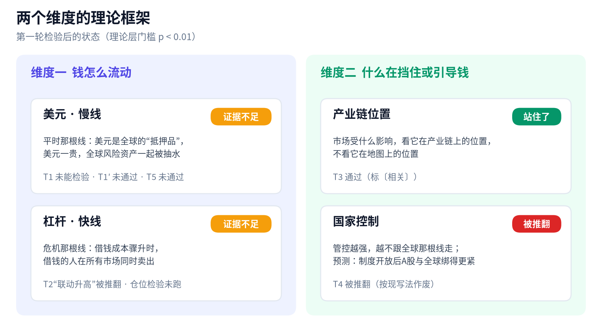

# 市场底层理论：第一轮检验报告

> 全球股市研究团队 · 2026年10月16日（台北时间）· 第一轮 · 本报告只陈述已跑检验的结果，不构成投资建议

## 一句话结论

第一轮只有一块砖站住了：**亚洲科技股跟着全球芯片产业链走，不跟着地理位置走**（T3，标〔相关〕）。“钱怎么流动”这一边，也就是美元慢线和杠杆快线，目前是**证据不足**，不是“已经检验过、找不到证据”。

## 理论框架：两个维度

团队提出了四条候选理论，正好拼成两个问题：**钱是怎么在全球流动的**（美元慢线、杠杆快线），以及**什么在挡住或引导这些钱**（产业链位置、国家控制）。每条理论都在看数据之前登记了专门检验和失效标准。

## 先看懂几个词

| 词 | 大白话 |
|---|---|
| p 值 | 结果纯属运气的可能性。越小越不像运气 |
| 门槛 | 事先定好的及格线。理论层 5 项检验，p 要小于 0.01；元素层 25 项检验按 Holm 校正，最严的一项要小于 0.002 |
| 共同主线 | 全球主要股市一起涨跌的那部分，先把它扣掉，才看得出各市场自己的联系 |
| 〔相关〕 | 经常一起动，但还不能说谁推动谁。本轮所有结论最高只到这一级 |
| 稳健性检查 | 换一种算法再跑一遍，看结论稳不稳。它不能用来推翻或改写主结论 |

## T1 到 T5：逐条结果

| 编号 | 理论 | 检验的问题 | 结果 |
|---|---|---|---|
| T1 / T1′ | 美元慢线 | 美元债务越重的市场，利率推动的美元走强时是否伤得越重 | T1 **未能检验**；替补 T1′ **未通过** |
| T2 | 杠杆快线 | 日元急升时，市场之间的联动是否真的升高 | **被推翻**（“联动升高”这一部分） |
| T3 | 产业链位置 | 扣掉共同主线后，台韩科技股是否更贴近费半，而不是港股、A股 | **通过**，标〔相关〕 |
| T4 | 国家控制 | 沪港通、纳入 MSCI 之后，A股与全球的联动是否持续上升 | **被推翻**，按现写法作废 |
| T5 | 美元能否管到 A股 | 利率推动的美元走强周里，A股是否跟着跌 | **未通过** |

**T1 美元债务：未能检验，替补 T1′ 未通过。** 原定数据（BIS 全球流动性指标）在 10 个市场里缺了 5 个，登记的“占 GDP 比例”这个变量也不存在，所以 T1 标“未能检验”，不算推翻也不算通过。替补 T1′ 改用 BIS 银行跨境美元债权（对非银行、2015 年底）除以 IMF 的 2015 年 GDP，共 9 个市场（欧股因口径不干净拿掉）。9 个市场的排序相关为 0.58，p = 0.050，没过 0.01 的门槛，也低于事先说明的约 0.78，不通过。去掉香港后，排序相关为 0.81，p = 0.0075，但这只是稳健性检查，不能翻转主结论，只算启发，已登记为 F4，以后用新数据复验。

**T2 杠杆联动：被推翻。** 42 个日元急升事件，窗口去重后共 161 周，对照 584 周，6 个市场两两配成 15 对。直接算的平均相关是事件期 0.669、平时 0.638，事件期只高一点。按事先定的 Forbes-Rigobon 方法，扣掉“波动变大自然会抬高相关”的部分以后，事件期反而降到 0.541，差值 −0.096，p = 0.9985。这个方法偏保守，所以结论只能写成：日元急升时市场一起跌，可以用“波动变大”解释完，看不出额外的联动。这**不等于“杠杆不存在”**。核心检验“仓位越大、跌得越深”还没跑。

**T3 产业链：通过，标〔相关〕。** 先把美、欧、日共同主线扣掉，再看剩下的部分跟谁联动：

| 组别 | 跟费半 | 跟恒指 | 跟上证 | 费半胜出的 p 值（对恒指 / 对上证） |
|---|---|---|---|---|
| 台湾科技（台积电） | 0.35 | 0.18 | 0.10 | ≤ 0.0005 / ≤ 0.0005 |
| 韩国科技（三星、SK海力士） | 0.28 | 0.11 | 0.14 | ≤ 0.0005 / 0.003 |
| 台湾非科技（反向对照） | 0.01 | 0.30 | — | 只作描述 |
| 韩国非科技（反向对照） | 0.04 | 0.20 | — | 只作描述 |

非科技股的方向正好相反，说明费半测到的是产业链联动，不是全球风险情绪。两点保留：台积电的美国存托凭证本身是费半成分股，台湾这一半**部分是机械相关**，结论主要靠韩国撑着；韩国对上证那一项 p = 0.003，离门槛不远。已登记 F3，用新数据复验。

**T4 国家控制：被推翻。** A股对共同主线的暴露（美元口径）是先升后降：沪港通前 1.08%，沪港通到纳入 MSCI 2.47%，纳入 MSCI 至今 1.22%。第三段对第一段，美元口径 p = 0.23，本币口径 p = 0.45。去掉 2015 年股灾那段，第二段降到 1.91%，结论不变。被推翻的是事先登记的预测“制度开放会让 A股跟全球绑得更紧”；若改成“随政策周期起伏”，就算一条新理论，必须重新登记。

**T5 美元能否管到 A股：未通过。** 38 个利率推动的美元走强周里，上证本币口径平均每周跌 0.58%，对照组涨 0.13%，p = 0.14；美元口径跌 0.92%、对照涨 0.18%，p = 0.052。方向与美元理论一致，但两版都没过 0.01，所以美元理论有边界，目前没有证据说它能穿过资本管制管到 A股。对照组按规定是 755 周，实际 747 周，少掉的 8 周都是长假碰上周一休市（A股按“周一收盘对下周一收盘”计算），按规则跳过，不补值。

## 元素层：两个硬结论

元素层是 25 项具体检验（A4 与 A6 被发现是同一个检验，已合并；登记表写明“看到结果后发现重复，因此合并，不影响结论”），最严门槛 0.002。目前有两条结论站得住：

**1. “费半领先台韩”是时差造成的假象。** 按周对齐时差后，上一周的费半对下一周的台股、韩股没有预测力（S1：p = 0.32；S2：p = 0.58）。所以这里没有可以提前布局的领先，只能标〔相关〕。

**2. 美元因美国利率上升而走强时，韩股明显跑输美股（D5）。** 这是全队唯一通过的主检验，换一种取价方法重跑也照样通过：

| 取价方法 | 利率推动周相对美股 | 对照周相对美股 | p 值 |
|---|---|---|---|
| 方法 A：周五之后最近的周一收盘 | −1.46% | +0.10% | 0.00088 |
| 方法 B：`W-MON` 重采样 | −1.74% | +0.12% | 0.000072 |

两种方法的 p 值都低于 0.002，所以 D5 不是靠挑取价方法才通过的。同组的台股 D3 没过（方法 A 下 p = 0.068，方法 B 下 p = 0.020），避险推动周 D4、D6 也没过。**以后亚洲周回报统一用 `W-MON` 取价**，理由是它是标准函数，别人用同一份代码能复现。选它不是因为它的结果更显著。

## “钱怎么流动”：证据不足

这一边的正确说法是**证据不足**，原因有两个：

1. **理论层的检验没通过**：T1′、T2、T5 都没过门槛，T1 未能检验。
2. **欧美和宏观的具体检验有一大半还没跑**，包括：6.2.2“紧缩推动周里成长股是否跑输价值股”；日元核心检验“仓位越大是否跌得越深”；6.2.4 到 6.2.7，即黄金、美元对美股、原油分供给和需求、美股对欧股。

因此**不能写成“已经检验过、找不到证据”**。亚洲部分这一轮该跑的已经跑完（S1–S2、A1–A6、D3–D6、T3、T4、D5 稳健性），两边不要混在一起。

## 这套体系现在怎么用

- **看台韩科技股，先看全球芯片产业链**（费半、AI 资本开支、存储周期），不要把它们当成“亚洲市场”一起看。
- **费半当同步参照，不当领先信号**：它不能提前预告下一周的台韩走势。
- **盯“利率推动的美元走强”对韩股的压力**：这是目前唯一通过的规律；台股的同类影响证据不够。
- **A股不要套用“全球联动”或“美元抽水”的逻辑**：目前两条都没有证据。
- **美元和杠杆两条线先当假设用**：可以作为观察框架，但不能当作已验证的规律来下判断。
- **所有结论最高到〔相关〕**：要升到〔因果〕，必须用以后的新数据再检验一次。

## 下一轮方向

1. **补齐欧美宏观检验**（第二轮证据），按优先级：先跑 6.2.2 和日元仓位，再跑美元、美欧对比、原油、黄金。结果出来后补进本报告。
2. **新数据复验**：
   - F1：从 2026 年 10 月起，紧缩推动周攒满 30 周再跑；
   - F2：共同主线与美元的关系；
   - F3：用新数据复验 T3；
   - F4：美元债务假说，必须控制各市场对美元的敏感度和汇率波动率，因为“债务重”可能只是“高波动新兴市场”的附带特征。
3. **重新提理论**：国家控制理论若要改写，按新理论重新登记；“能预判”必须用样本外检验，也就是先用过去的数据定好规则，再对从没用过的那段数据做预测，结果还要比简单的基准好。

## 局限

- 结论“撑住”的意思只是这一次检验没被推翻。T2 所用的 Forbes-Rigobon 方法偏保守。
- 数据和口径上的问题：
  - T1′ 只有 9 个点；香港的比值是极端值，排第一；墨西哥数据有统计口径断点；IMF 的 GDP 用的是最新修订值；印尼盾汇率（Yahoo `IDR=X`）是开跑时才补的来源。
  - 亚洲周回报的取价方法会带来约 0.3 个百分点的实现误差，已锁定用 `W-MON`。
  - A股改用上证综指，因为沪深 300 的历史数据下载不到；两者口径不完全相同。
  - T3 的非科技股是手工挑选的，台湾科技组只有台积电一只。
- 本报告不构成投资建议。
