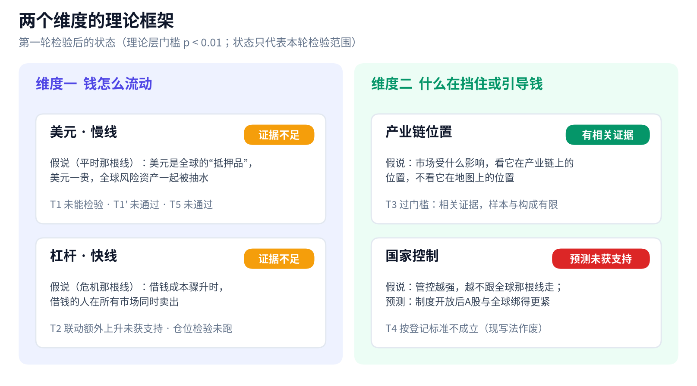

# 市场底层理论：第一轮检验报告（修订版）

> 全球股市研究团队 · 2026年10月16日（台北时间）· 第一轮 · 按妮可修订意见第一至五节修改，数字均与原版相同 · 不构成投资建议

## 一句话结论

第一轮里，只有产业链这条找到了**相关证据**。在本轮选取的台韩科技股样本、共同主线处理方式和比较基准下，这些股票扣掉共同主线后与费半的剩余联动，强于与恒指、上证的联动（T3，标〔相关〕）。这与“看产业链位置”的解释相符，但还没排除其他共同因素，也不能推广到所有亚洲科技股。

“钱怎么流动”这一边，也就是美元慢线和杠杆快线，目前是**证据不足**：理论层检验没有通过，欧美宏观的具体检验大半还没跑。不能写成“已经检验过、找不到证据”。

**读法**：下面每条结论都分三步说清，**检验了什么 → 支持到哪一步 → 还没检验什么**。

## 理论框架：两个维度

团队提出了四条候选理论，可以拼成两个问题：**钱是怎么在全球流动的**（美元慢线、杠杆快线），以及**什么在挡住或引导这些钱**（产业链位置、国家控制）。每条理论都在看数据之前登记了专门检验和失效标准。图中的状态只代表本轮检验的范围。

## 先看懂几个词

| 词 | 大白话 |
|---|---|
| p 值 | 先假设“其实没有这种关系”，并且统计模型的其他假设都成立；在这个前提下，出现眼前这么极端、或更极端结果的概率。它**不是**“结果纯属运气的概率”，也**不是**理论为真的概率。p 值小，本身不能证明因果，也不能证明有实际用处 |
| 门槛 | 事先定好的及格线。理论层 5 项检验，p 要小于 0.01；元素层 25 项检验按 Holm 校正，最严的一项要小于 0.002 |
| 共同主线 | 全球主要股市一起涨跌的那部分。先把它扣掉，才看得出各市场之间剩下的联系 |
| 〔相关〕 | 经常一起动，但还不能说谁推动谁。本轮所有结论最高只到这一级 |
| 稳健性检查 | 换一种算法再跑一遍，看结论稳不稳。它不能用来推翻或改写主结论 |

## T1 到 T5：逐条结果

| 编号 | 理论 | 检验的问题 | 本轮结果 |
|---|---|---|---|
| T1 / T1′ | 美元慢线 | 美元债务越重的市场，在利率推动的美元走强时是否伤得越重 | T1 **未能检验**；替补 T1′ **未通过** |
| T2 | 杠杆快线 | 日元急升时，市场之间的联动是否额外升高 | **未获支持**（按预先规定的校正方法） |
| T3 | 产业链位置 | 扣掉共同主线后，台韩科技股是否更贴近费半，而不是港股、A股 | **通过门槛**，属相关证据，标〔相关〕 |
| T4 | 国家控制 | 沪港通开通、纳入 MSCI 之后，A股与全球的联动是否持续上升 | **按登记标准不成立**，这条理论按现在的写法作废 |
| T5 | 美元能否管到 A股 | 利率推动的美元走强周里，A股是否跟着跌 | **未通过** |

**T1 美元债务：未能检验；替补 T1′ 未通过。**

- **检验了什么**：原定数据（BIS 全球流动性指标）在 10 个市场里缺了 5 个，登记的“占 GDP 比例”这个变量也不存在，所以 T1 标为“未能检验”，既不算推翻，也不算通过。替补 T1′ 改用 BIS 银行跨境美元债权（对非银行、2015 年底）除以 IMF 的 2015 年 GDP，共 9 个市场；欧股因口径不干净拿掉。
- **支持到哪一步**：9 个市场的排序相关为 0.58，p = 0.050，没过 0.01 的门槛，也低于事先说明的约 0.78，所以不通过。去掉香港后，排序相关为 0.81，p = 0.0075。但这只是稳健性检查，不能翻转主结论，只算启发。
- **还没检验什么**：“去掉香港”这条线索已登记为 F4，以后用新数据复验，届时必须控制各市场对美元的敏感度和汇率波动率。

**T2 杠杆联动：未获支持。**

- **检验了什么**：42 个日元急升事件，窗口去重后共 161 周，对照组 584 周，6 个市场两两配成 15 对。直接算的平均相关，事件期是 0.669，平时是 0.638。按预先规定的 Forbes–Rigobon 校正（扣掉“波动变大会自然抬高相关”的部分），事件期是 0.541，差值 −0.096，p = 0.9985。
- **支持到哪一步**：按这一校正，本轮**没有**看到“事件期跨市场相关性额外上升”的证据。这个检验只针对一种特定的联动指标，不能单独证明“市场一起下跌已经完全可以用波动变化解释”，也不等于日元去杠杆机制不存在。
- **还没检验什么**：直接检验“仓位越大、跌得越深”的那一项还没做完。
- **说明**：如果以后要换方法，应先说清楚新方法回答的是什么不同的问题，并且要接受结果可能继续不支持原假说。“杠杆理论被误杀”“换新方法把理论救回来”这类说法，是外部点评加上的解释，不是本轮检验得到的事实。

**T3 产业链：通过门槛，属相关证据。** 先把美、欧、日共同主线扣掉，再看剩下的部分跟谁联动：

| 组别 | 跟费半 | 跟恒指 | 跟上证 | 费半胜出的 p 值（对恒指 / 对上证） |
|---|---|---|---|---|
| 台湾科技（台积电） | 0.35 | 0.18 | 0.10 | ≤ 0.0005 / ≤ 0.0005 |
| 韩国科技（三星、SK海力士） | 0.28 | 0.11 | 0.14 | ≤ 0.0005 / 0.003 |
| 台湾非科技（反向对照） | 0.01 | 0.30 | — | 只作描述 |
| 韩国非科技（反向对照） | 0.04 | 0.20 | — | 只作描述 |

- **检验了什么**：台韩科技股，在扣掉美欧日共同主线之后，与费半、恒指、上证的剩余联动孰强孰弱；非科技股作为反向对照。
- **支持到哪一步**：在本轮选取的台韩科技股样本、共同因子处理和比较基准下，科技股与费半的剩余联动强于与恒指、上证的联动；非科技股对照的方向不同，提供了补充证据。这与产业链位置的解释相符，但仍属相关证据，还没排除其他共同因素，也不能直接推广到所有亚洲科技股。
- **样本与构成限制**：台湾科技组只有台积电一只，而且台积电的美国存托凭证（ADR）本身就是费半成分股，所以台湾这一半有一部分是机械相关。韩国对上证那一项 p = 0.003，离门槛不远。
- **还没检验什么**：新数据复验已登记为 F3。

**T4 国家控制：按登记标准不成立。**

- **检验了什么**：A股对共同主线的暴露，在沪港通开通、纳入 MSCI 前后的三段时间里是否持续上升。
- **支持到哪一步**：暴露（美元口径）先升后降：沪港通前 1.08%，沪港通到纳入 MSCI 2.47%，纳入 MSCI 至今 1.22%。第三段对第一段，美元口径 p = 0.23，本币口径 p = 0.45。去掉 2015 年股灾那段，第二段降到 1.91%，结论相同。事先登记的预测“制度开放会让 A股跟全球绑得更紧”没有得到支持，这条理论按现在的写法作废。
- **还没检验什么**：若改成“随政策周期起伏”之类的说法，就算一条新理论，必须重新登记、重新检验，不能拿这次第二段的上升当证据。

**T5 美元能否管到 A股：未通过。**

- **检验了什么**：38 个利率推动的美元走强周，与对照周比较上证的表现。对照组按规定是 755 周，实际 747 周。少掉的 8 周都是长假碰上周一休市（A股按“周一收盘对下周一收盘”计算），按规则跳过，不补值。
- **支持到哪一步**：本币口径，平均每周跌 0.58%，对照组涨 0.13%，p = 0.14；美元口径，跌 0.92%，对照组涨 0.18%，p = 0.052。方向与美元理论一致，但两版都没过 0.01 的门槛。所以本轮没有得到“美元这根线能穿过资本管制管到 A股”的支持；但这也不能据此断定美元对 A股没有影响。
- **还没检验什么**：上证代替沪深 300 带来的口径差异，以及更长样本或新数据下的表现。

## 元素层：两条主要结果

元素层是 25 项具体检验（A4 与 A6 被发现是同一个检验，已合并；登记表写明“看到结果后发现重复，因此合并，不影响结论”），最严门槛 0.002。

**1. 费半是否领先台韩（S1、S2）：尚未检出周度领先。**

- **检验了什么**：按本轮的周度时差对齐和所用模型，检验上一周的费半能否帮助预测下一周的台股、韩股。
- **支持到哪一步**：尚未检出这种预测力（报告值：S1 p = 0.32；S2 p = 0.58）。因此目前**不把它作为已验证的周度领先信号**。这一结果不能单独证明先前看到的“领先”全部是时差造成的。
- **还没检验什么**：日内或隔夜的关系还没检验。要判断能否排除“有实际意义的预测效果”，还需要看效应估计、区间和检验能力。

**2. 美元因美国利率上升而走强时，韩股在本轮样本中跑输美股（D5）。** 这是全队唯一通过门槛的主检验，换一种取价方法重跑也照样通过：

| 取价方法 | 利率推动周相对美股 | 对照周相对美股 | p 值 |
|---|---|---|---|
| 方法 A：周五之后最近的周一收盘 | −1.46% | +0.10% | 0.00088 |
| 方法 B：`W-MON` 重采样 | −1.74% | +0.12% | 0.000072 |

- **检验了什么**：在利率推动的美元走强周和美元没走强的对照周里，比较韩股美元回报相对标普 500 的差别。
- **支持到哪一步**：两种取价方法的 p 值都低于 0.002，所以这项结论在本轮试过的两种取价方法下都成立，不是靠挑方法得出的。它属于相关证据，说明这两件事在本轮样本里同时出现，不代表已经证明了因果。同组的台股 D3 没过门槛（方法 A 下 p = 0.068，方法 B 下 p = 0.020），避险推动周 D4、D6 也没过。
- **还没检验什么**：用新数据复验，以及更换样本区间后是否仍然成立。
- **取价规则**：以后亚洲周回报统一用 `W-MON` 取价，理由是它是标准函数，别人用同一份代码能复现。选它不是因为它的结果更显著。

## “钱怎么流动”：证据不足

这一边的正确说法是**证据不足**，原因有两个：

1. **理论层的检验没通过**：T1′、T2、T5 都没过门槛，T1 未能检验。
2. **欧美和宏观的具体检验有一大半还没跑**，包括：6.2.2“紧缩推动周里成长股是否跑输价值股”；日元核心检验“仓位越大是否跌得越深”；6.2.4 到 6.2.7，也就是黄金、美元对美股、原油分供给和需求、美股对欧股。

因此**不能写成“已经检验过、找不到证据”**。亚洲部分这一轮该跑的已经跑完（S1–S2、A1–A6、D3–D6、T3、T4、D5 稳健性），两边不要混在一起。

## 从相关到因果

新数据复验是用来检查一个关系能不能重现，以及在样本外是否稳定。如果要作因果判断，还需要可信的因果识别设计，并说明怎么处理共同冲击、混杂因素和反向因果。**重复观察到相关关系，本身不会自动升级为因果。**

## 这套体系现在怎么用

- **看台韩科技股，可以优先参照全球芯片产业链**（费半、AI 资本开支、存储周期）。这是基于本轮少数科技公司样本的相关证据，不代表整个台韩市场都没有自己的走势。
- **费半目前不作为已验证的周度领先信号**；日内和隔夜关系尚未检验。
- **留意“利率推动的美元走强”与韩股相对走弱同时出现的情况**：这是目前唯一通过门槛的结果，属相关证据；台股的同类结果没过门槛。
- **A股方面，“制度开放后与全球联动更紧”和“美元能管到 A股”这两条，本轮都没有得到支持**，暂不作为判断依据。但这不等于已经证明它们不成立。
- **美元和杠杆两条线先当假设用**：可以作为观察框架，但不能当作已验证的规律来下判断。
- **所有结论最高到〔相关〕**：新数据复验只能检查关系是否重现；要讲因果，还需要因果识别设计（见上一节）。

## 下一轮方向

1. **补齐欧美宏观检验**（第二轮证据），按优先级：先跑 6.2.2 和日元仓位，再跑美元、美欧对比、原油、黄金。结果出来后补进本报告。
2. **新数据复验**（检查能否重现、样本外是否稳定）：
   - F1：从 2026 年 10 月起，紧缩推动周攒满 30 周再跑；
   - F2：共同主线与美元的关系；
   - F3：用新数据复验 T3；
   - F4：美元债务假说，必须控制各市场对美元的敏感度和汇率波动率，因为“债务重”可能只是“高波动新兴市场”的附带特征。
3. **重新提理论**：国家控制理论如果要改写，按新理论重新登记；“能预判”必须用样本外检验，也就是先用过去的数据定好规则，再对从没用过的那段数据做预测，结果还要比简单的基准好。

## 局限

- 结论“通过”的意思只是这一次在登记口径下过了门槛；“未通过”“未获支持”的意思只是本轮没有得到支持，不等于已经证明不存在。审查员事先指出，T2 所用的 Forbes–Rigobon 方法偏保守。
- 数据和口径上的问题：
  - T1′ 只有 9 个点；香港的比值是极端值，排第一；墨西哥数据有统计口径断点；IMF 的 GDP 用的是最新修订值；印尼盾汇率（Yahoo `IDR=X`）是开跑时才补的来源。
  - 亚洲周回报的取价方法会带来约 0.3 个百分点的实现误差，已锁定用 `W-MON`。
  - A股改用上证综指，因为沪深 300 的历史数据下载不到；两者口径不完全相同。
  - T3 的非科技股是手工挑选的，台湾科技组只有台积电一只。
- 本报告不构成投资建议。
